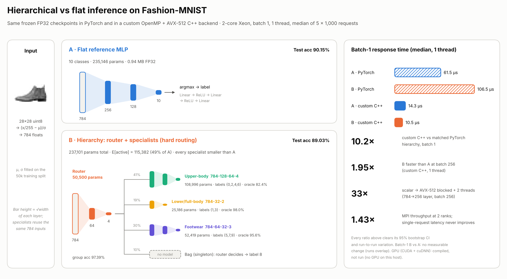

# Parallel Fashion Intelligence Challenge

A hierarchical Fashion-MNIST classifier (router + 3 specialists + singleton) with a flat
PyTorch reference, a matched PyTorch hierarchy, a custom OpenMP + AVX-512 CPU backend,
MPI distribution (mpi4py, both backends), and a CUDA/cuDNN backend (compiled, **not run** —
the development machine has no GPU). The technical report is a separate document.



## Architectures

All models are MLPs (Linear → ReLU between layers) trained in PyTorch, selected on validation
data and frozen; the same checkpoints feed every backend.

| Model | Layers | Params | Role | Test result |
|---|---|---|---|---|
| A · Flat reference | 784 → 256 → 128 → 10 | 235,146 | all 10 classes | 90.15% accuracy |
| B · Router | 784 → 64 → 4 | 50,500 | picks the group from the image | 97.39% group accuracy |
| B · Upper-body specialist | 784 → 128 → 64 → 4 | 108,996 | T-shirt, Pullover, Coat, Shirt (41% of images) | 82.4% on true routes |
| B · Lower/full-body specialist | 784 → 32 → 2 | 25,186 | Trouser, Dress (19%) | 98.0% on true routes |
| B · Footwear specialist | 784 → 64 → 32 → 3 | 52,419 | Sandal, Sneaker, Ankle boot (30%) | 95.6% on true routes |
| B · Bag | no model | 0 | singleton group: the router's decision is the label (10%) | — |

Hierarchy B end to end: 89.03% test accuracy; 237,101 parameters in total, 115,382 active per
image on average (49% of A). Batch-1 median response time, 1 thread: A 61.5 µs (PyTorch) /
14.3 µs (custom C++), B 106.5 µs (PyTorch) / 10.5 µs (custom C++). Regenerate the figure with
`python3 visual_abstract.py` (it reads `results/accuracy.json` and `results/summary.json`).

## Layout

| Path | What |
|---|---|
| `common.py` | constants: groups, seeds, dataset I/O, benchmark sequence |
| `prepare_data.py` | stratified 50k/10k split (seed 2038), preprocessing stats on train only |
| `train.py` | trains candidates, selects on validation, freezes; writes `checkpoints/` |
| `torch_models.py` | MLP, flat reference and matched PyTorch hierarchy (cpu or cuda) |
| `evaluate.py` | accuracy, macro-F1, recall, router confusion, oracle; `results/accuracy.json` |
| `cpu/hpc_cpu.cpp`, `cpu/build.sh` | custom backend (scalar / omp simd / AVX-512 ILP / blocked kernels, OpenMP) |
| `cpu/asm_evidence.py` | extracts vector width + accumulator evidence from the disassembly |
| `custom_backend.py` | ctypes binding (raw-pointer default, `ndpointer` variant for the ablation) |
| `correctness.py` | custom vs PyTorch on all 10,000 test images; edge cases |
| `bench.py` | single-process response-time benchmark (one fresh process per repetition) |
| `ablation_dense.py` | kernel ablation on the 784→256 layer |
| `mpi_hier.py` | MPI coordinator/workers; modes `test`, `bench`, `throughput` |
| `gpu/gpu_backend.cu`, `gpu/build.sh`, `gpu/export_gpu.py` | CUDA + cuDNN backend and driver |
| `run_all.sh` | full campaign; `analyze.py` statistics; `plots.py`, `diagram.py`, `visual_abstract.py` figures |
| `demo.py` | live demo (CPU backends side by side) |
| `data/` | `download.sh`, split indices (`train_idx.txt`, `val_idx.txt`, `split.npz`), `preprocess.json` |
| `checkpoints/` | frozen `.pt` (PyTorch) and `.bin` (raw FP32 W[O][I] then b per layer) + `manifest.json` with SHA-256 |
| `results/raw/` | every per-request CSV and per-run metadata JSON of the final campaign |
| `results/archive_campaign1/` | first campaign (ndpointer binding), kept for the binding finding |
| `results/summary.json`, `results/tables.md` | all statistics with bootstrap CIs and verdicts |
| `results/figures/` | figures 0–6 and `visual_abstract.png` / `.svg` |

## Reproduce

```bash
pip install torch numpy mpi4py matplotlib     # versions in results/logs/environment.txt
sudo apt-get install libopenmpi-dev openmpi-bin
bash data/download.sh
python3 prepare_data.py && python3 train.py && python3 evaluate.py
bash cpu/build.sh && python3 correctness.py
mpirun -np 4 --oversubscribe python3 mpi_hier.py --backend custom --mode test
bash run_all.sh && python3 analyze.py && python3 plots.py && python3 diagram.py && python3 visual_abstract.py
```

Training on 2 CPU cores takes about 3 minutes; the benchmark campaign about 7 minutes.
Retraining reproduces the same split exactly; weights may differ in the last bits across
PyTorch builds, so the shipped `checkpoints/` are the frozen ones used for every number.

## Live demo

```bash
python3 demo.py 8                                                     # CPU: custom vs PyTorch, per image
mpirun -np 2 python3 mpi_hier.py --backend custom --mode bench --n1 200 --nb 20   # MPI
cd gpu && bash build.sh && python3 export_gpu.py && ./build/gpu_bench gpu_config.txt ../results/raw 0   # GPU (needs a GPU)
```

## Hardware used for all measurements

2-core Intel Xeon (Sapphire Rapids family) KVM guest, AVX-512, 7 GiB RAM, no GPU.
g++ 13.3, Python 3.13, PyTorch 2.15.0 (MKL 2024.2), Open MPI 4.1.6, mpi4py 4.1.2.
